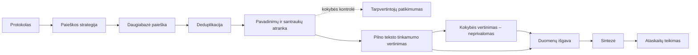

::: {.figure #fig:pipeline-overview alt="Linijinė dešimties etapų schema: protokolas, paieškos strategija, daugiabazė paieška, deduplikacija, pavadinimų ir santraukų atranka (su tarpvertintojų patikimumo kokybės kontrolės priedu), pilno teksto tinkamumo vertinimas, neprivalomas kokybės vertinimas, duomenų išgava, sintezė, ataskaitų teikimas. Iš pilno teksto tinkamumo vertinimo eina dvi rodyklės į duomenų išgavą: tiesiogiai (praleidžiant kokybės vertinimą, kaip tiriamosiose apžvalgose) ir per neprivalomą kokybės vertinimo etapą."}

1 pav. Automatizuotos literatūros apžvalgos konvejeris. Kokybės vertinimo etapas neprivalomas tiriamosioms (scoping) apžvalgoms; tarpvertintojų patikimumas rodomas kaip atrankos etapo kokybės kontrolės priedas, o ne atskiras nuoseklus etapas.
:::
